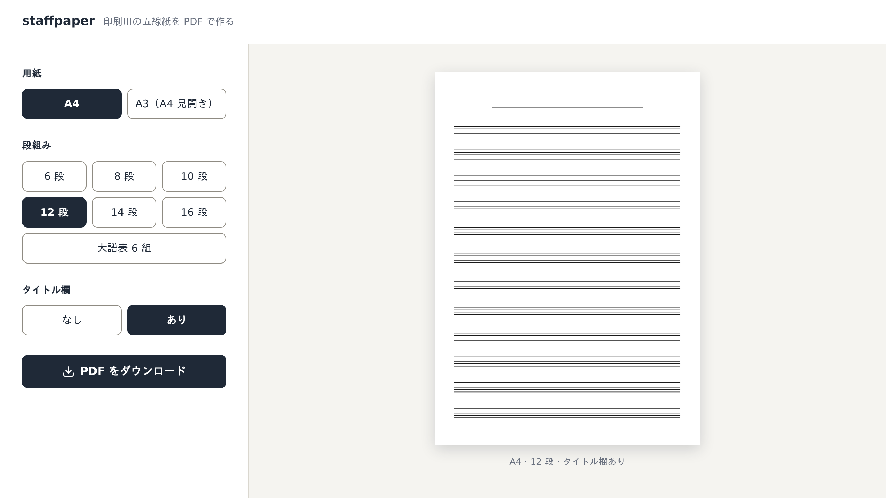

# staffpaper

**印刷用の五線紙を、ブラウザの中で PDF にします。**

### [staffpaper を開く →](https://staffpaper.koeda.me)

<picture>
  <source media="(prefers-color-scheme: dark)" srcset="docs/images/hero-dark.png">
  
</picture>

[できること](#できること) · [使い方](#使い方) · [このページについて](#このページについて) · [開発に加わる](#開発に加わる) · [ライセンス](#ライセンス)

手書きで曲を書き留めたいとき、好みの段数の五線紙をその場で刷れます。用紙と段組みを選ぶだけで、アプリの導入もアカウントも要りません。選んだ組み合わせの仕上がりを見せてから、そのまま印刷できる PDF を作ります。

## できること

- **用紙を選ぶ。** A4、または A3（A4 見開き。左右の面に A4 と同じ段組みを並べます）。
- **段組みを選ぶ。** 6・8・10・12・14・16 段、または大譜表 6 組。
- **タイトル欄をつける。** 上の余白の下に 20mm の欄を取り、中央に線を 1 本引きます。
- **仕上がりを見てから作る。** 選んだ組み合わせのプレビューは、PDF と同じ割り付けで描いています。見えている形がそのまま PDF になります。
- **どこにも送らない。** PDF はブラウザの中で作ります。選んだ内容も、作った PDF も、送らず・保存しません。

## 使い方

1. [ページ](https://staffpaper.koeda.me)を開きます。
2. 用紙・段組み・タイトル欄を選びます。右のプレビューが変わります。
3. **PDF をダウンロード**を押して、印刷します。

## このページについて

- 扱う情報: 入力は用紙や段組みの選択肢だけ。Cookie と `localStorage` は使わず、解析や広告のタグも無い
- 配信の事業者に届くもの: ページを開いたときのアクセスの記録（IP アドレスなど）。配信の事業者が HTML に差し込むスクリプトは、このページのヘッダ（CSP）で止めている
- 運営: koedame（個人）。問い合わせは GitHub の Issues、脆弱性は [SECURITY.md](SECURITY.md)
- robots.txt の `Content-Signal` は、サイトのページを巡回する側への意思表示で、ライセンスの条件ではありません。MIT のライセンスは変わらず、学習を含む用途にもその条件で使えます

## 開発に加わる

Issue と Pull Request を歓迎します。手元で動かす手順と構成は [CONTRIBUTING.md](CONTRIBUTING.md) を見てください。

## ライセンス

MIT（[LICENSE](LICENSE)）。無保証。画面のアイコンは Lucide のもので、その著作権表示と許諾の文面は [third-party-licenses.txt](public/third-party-licenses.txt) にあります。
